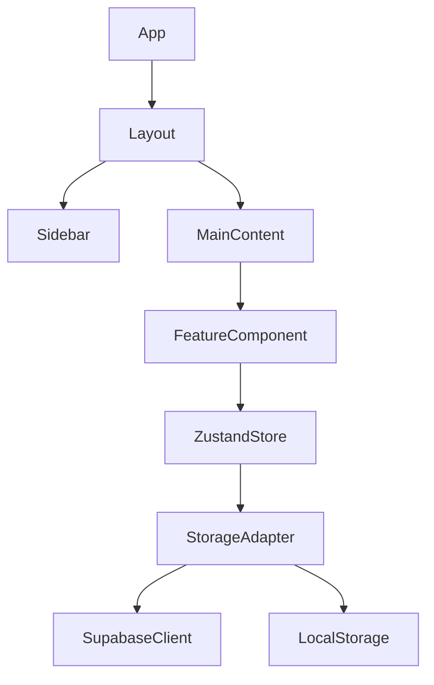

# ProfitsPatrol Architecture

## High-Level Overview
ProfitsPatrol uses a "Thick Client" architecture where most business logic resides in the frontend (Zustand stores), synchronized with a Supabase backend for persistence and multi-device support.

## Frontend Architecture
- **Feature-Based Modularity**: Each major domain lives in `src/features/{featureName}`. This ensures clear boundaries and scalability.
- **State Management**: Zustand aggregates multiple slices into a single store (`src/store/index.ts`). Slices are decoupled (e.g., `userSlice` vs `gameSlice`).
- **Persistence Layer**: A `StorageAdapter` pattern (`src/services/persistence`) allows switching between `LocalStorage` (demo/guest) and `Supabase` (authenticated users).

## Backend Architecture
- **Supabase**: Handles Auth, PostgreSQL, and Storage.
- **RLS (Row Level Security)**: Enforces data isolation per user/role at the database level.
- **Edge Functions**: Used for sensitive operations like parent-child linking, security auditing, and potentially heavy AI processing.

## State Management Flow
1. **Action Triggered**: UI component calls a store action (e.g., `completeLesson`).
2. **Logic Execution**: Store updates local state (XP, Tokens).
3. **Persistence Sync**: Zustand middleware triggers the `SupabaseAdapter` to sync changes to the cloud.

## Modular Boundaries
Features should be self-contained. 
- Shared utilities go to `src/utils`.
- Shared components go to `src/components`.
- Infrastructure integrations go to `src/lib`.

## Scaling Strategy
- **Code Splitting**: Route-level lazy loading reduces initial bundle size.
- **Database**: Indexing on `user_id` and `created_at` for high-traffic tables.
- **Asset Optimization**: Local assets are served with appropriate caching headers (handled via Vercel).
